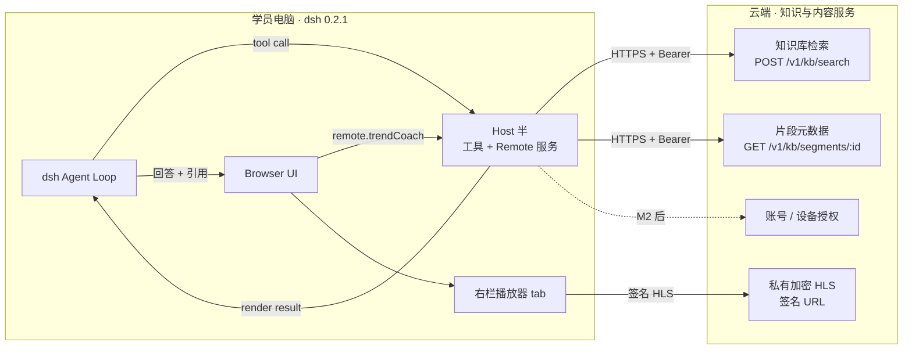
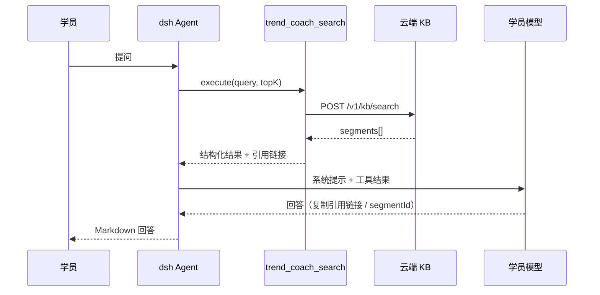
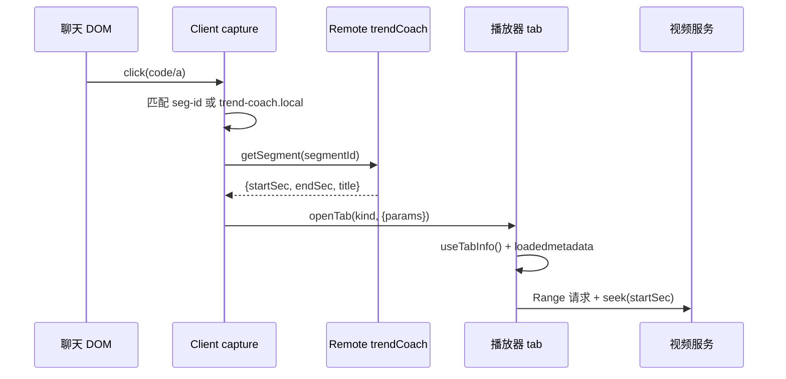

# 趋势伴学插件 · 架构设计（v1.0）

- 状态：v1.0，基于 PRD v1.2 与 dsh 0.2.1-rc.5 实测结论
- 日期：2026-10-31
- 上游文档：[产品需求文档](../requirements/product-requirements.md)
- 配套规范：[项目规范](../conventions/project-conventions.md)

---

## 1. 目标与范围

本文定义 `dsh-plugin-trend-coach` 的运行时架构、模块边界、接口契约与演进路径，作为 M2 及后续里程碑的实现依据。

**在范围内**

- 学员本地 dsh 客户端中的插件：Host 半（工具 + Remote 服务 + 云端访问）与 Browser 半（右栏问答面板、播放器）。
- 与云端知识库、视频分发、账号体系的接口边界。
- M2 核心链路：课程问答 → 引用 → 视频定位。

**不在范围内**

- 云端检索、内容生产、后台管理的内部实现（仅在契约层约束）。
- 多模态输入、AI 互动课堂、体系页的详细设计（M3–M5 单独补充设计章节）。
- dsh 本体与 cordis 框架的改造。

---

## 2. 设计原则与约束

| 原则 | 含义 |
|---|---|
| 宿主优先 | 推理、会话、凭据由 dsh 提供（BYOK）；插件不自建模型调用链 |
| 只读云端 | 一期云端只提供检索、片段元数据与视频分发，不接收写入 |
| 契约显式 | 工具、Remote、云端接口均有可校验的 schema；跨边界数据先校验后使用 |
| 引用可溯源 | 引用只能来自云端返回的 `segmentId`，模型不得生成时间点/链接 |
| 最小权限 | 不注册 shell / 文件写入工具；不另起 HTTP 端口；不采集未声明数据 |
| 平台约束内建 | dsh 的注入顺序、Markdown 限制、Range 要求等硬约束进入代码结构，而非注释提醒 |

**版本基线**：dsh `0.2.1-rc.5`、cordis `~4.0.5`、schemastery `~3.18.5`、zod `4.4.3`。预览期不追 latest，升级需过兼容矩阵（见 §14）。

---

## 3. 系统上下文



**职责边界**

| 端 | 负责 | 不负责 |
|---|---|---|
| Host 半 | 工具注册、云端检索、片段查询、入参校验、超时与取消 | 渲染、播放、模型推理 |
| Browser 半 | 右栏面板、引用点击、播放器定位、UI 状态 | 直接访问云端、持有长期凭据 |
| dsh | agent loop、LLM、会话、权限、profile 管理 | 课程内容与检索 |
| 云端 | 账号、知识库、embedding、视频分发、限流 | 推理与 agent 编排 |

---

## 4. 运行时架构

### 4.1 Host 半

当前实现集中在 `src/index.ts`，职责链如下：

```
apply(ctx, config)
├── 读取 Config（baseUrl / apiToken? / timeoutMs）
├── new TrendCoachService(ctx, config)        // TypertRemoteService('trendCoach')
│   ├── @Remote search(query, topK, signal)   → POST /v1/kb/search
│   └── @Remote getSegment(segmentId, signal) → GET  /v1/kb/segments/:id
└── ctx.tools.register(defineTool(trend_coach_search))
    ├── parameters: query / courseId? / topK?
    ├── output.schema + render
    └── execute → searchKnowledge(...)
```

**关键点**

- 工具与 Remote 共用同一个 `searchKnowledge()`，避免两套检索逻辑漂移。
- 所有请求合并调用方 `AbortSignal` 与 `AbortSignal.timeout(timeoutMs)`，工具透传 `exec.signal`。
- 云端响应在边界处做结构校验（`isSegment`），非法数据直接报错，不进入模型上下文。

**后续拆分触发条件**（满足任一即拆分，避免过早抽象）：

- 出现第 3 个云端端点，或检索/鉴权逻辑超过 ~150 行。
- 引入账号设备码授权、学习进度上报。
- 需要单测覆盖纯函数（RRF/截断/URL 构造）。

建议拆分：`src/host/kb-client.ts`（HTTP + 校验）、`src/host/tool.ts`、`src/host/service.ts`、`src/shared/contracts.ts`（类型与 zod schema）。

### 4.2 Browser 半

当前实现集中在 `src/client/index.ts`，启动顺序是硬约束：

```
apply(ctx)
├── ctx.effect($mount(remote info))            // 先挂载 Remote
│   └── 成功后 ctx.inject(['remote.trendCoach'], scoped => …)
│       ├── scoped.slots.inject('sidebar.right.pane.tab', Panel)
│       └── scoped.effect(document capture click handler)
├── ctx.effect(sidebarRightTabs.register(检索 tab, guide: [ ... ]))
├── ctx.effect(sidebarRightTabs.register(播放器 tab, guide: [ ... ]))
└── ctx.slots.inject('sidebar.right.pane.tab', Player)
```

**模块职责**

| 模块 | 职责 |
|---|---|
| `Panel` | 输入问题 → Remote 检索 → 渲染片段列表 → 点击打开播放器 |
| `Player` | 读取 `useTabInfo()` 的 params/revision → `<video>` → `loadedmetadata` 后 seek |
| `parseCitation` | 解析 `https://trend-coach.local/segment/:id?t&e`，拒绝其他 host |
| capture handler | 优先处理引用链接，其次处理 `seg-xxx` 代码块；其余点击放行 |

**引用点击双路径**

1. 主路径：`<code>seg-xxx</code>` → `getSegment` → `openTab(player, params)`。不依赖模型配合，历史回答同样可用。
2. 备选：`https://trend-coach.local/...` 链接在 capture 阶段拦截。链接可点，但模型未必原样复制，不能作为唯一方案。

### 4.3 云端知识服务（契约视角）

| 能力 | 接口 | 当前状态 |
|---|---|---|
| 混合检索 | `POST /v1/kb/search` | 契约已定，mock 已验证 |
| 片段元数据 | `GET /v1/kb/segments/{segmentId}` | 契约已定，mock 已验证 |
| 账号 / 设备码 | 待定 | M3 设计 |
| 视频签名 HLS | 待定 | D3，接云点播后落地 |
| 学习进度 | 待定 | M3 |

---

## 5. 关键链路

### 5.1 课程问答



**要求**：工具描述明确「回答课程内容前必须先调用」；无召回时返回固定文案，模型必须回答「课程未覆盖」。

### 5.2 引用点击 → 播放定位



**验收口径**：跳转成功率 ≥ 99%，seek 误差 ≤ 2s。服务端必须支持 HTTP Range。

### 5.3 右栏主动检索

`Panel` → `scoped.remote.trendCoach.search(query, 5)` → 渲染片段按钮 → 与 5.2 相同的播放器路径。该链路不经过模型，可用于自检和调试。

---

## 6. 接口契约

### 6.1 工具 `trend_coach_search`

**入参**

| 字段 | 类型 | 必填 | 说明 |
|---|---|---|---|
| `query` | string | 是 | 学员问题检索语句 |
| `courseId` | string | 否 | 限定课程 |
| `topK` | number | 否 | 默认 5 |

**输出**

```jsonc
{
  "query": "string",
  "segments": [{
    "segmentId": "string",
    "courseId": "string",
    "chapterId": "string",
    "knowledgePointId": "string",
    "title": "string",
    "startSec": 0,
    "endSec": 0,
    "text": "string",
    "score": 0.0
  }]
}
```

**渲染约定**：每个片段附 `https://trend-coach.local/segment/<segmentId>?t=<start>&e=<end>`，并指示模型原样复制、不得自行生成时间点。空结果渲染固定拒答文案。

### 6.2 Remote 方法

| 方法 | 入参（位置参数） | 结果 |
|---|---|---|
| `trendCoach/search` | `query: string, topK: number, signal` | `{query, segments[]}` |
| `trendCoach/getSegment` | `segmentId: string, signal` | `Segment` |

- 客户端调用返回 `{ ok: true, value } | { ok: false, error }`。
- spec 的 `package` 必须为 `dsh-plugin-trend-coach`；method wire 名为 `服务名/方法名`；result 使用 strict codec。
- `signal` 固定为最后一个参数，服务端必须转发到 fetch。
- 客户端先 `$mount`，成功后再动态 `inject(['remote.trendCoach'])`；**禁止**写入静态 `inject`。

### 6.3 云端 HTTP

**检索**

```http
POST /v1/kb/search
Authorization: Bearer <token>
Content-Type: application/json

{ "query": "...", "topK": 5, "courseId": "optional" }
```

响应 `{ "segments": Segment[] }`；`score` 为 0–1。

**片段**

```http
GET /v1/kb/segments/{segmentId}
Authorization: Bearer <token>
```

**错误语义**：`401/403` 未授权（提示重新登录）、`404` 片段不存在（提示内容已下架）、`429` 限流（退避提示）、`5xx` 服务不可用（可重试提示）。响应必须是 JSON 对象；`segments` 必须是数组；任一元素不合法则整体失败，不做静默丢弃。

### 6.4 播放器 tab 与引用 URL

**tab 参数**

| 字段 | 类型 | 必填 |
|---|---|---|
| `segmentId` | string | 否（无片段时展示空播放器） |
| `title` | string | 否 |
| `startSec` | number | 否 |
| `endSec` | number | 否 |
| `src` | string | 否（默认由配置/云端签名提供） |

同一 tab 重复打开通过 `navigation.revision` 触发重新定位。

**引用 URL**：`https://trend-coach.local/segment/{encodeURIComponent(segmentId)}?t={startSec}&e={endSec}`。客户端只接受该 host 与 `/segment/` 前缀。

### 6.5 数据模型与不变量

| 不变量 | 说明 |
|---|---|
| `segmentId` 全局唯一且稳定 | 跨版本、跨回答可复用；下架后返回 404 |
| `startSec < endSec`，整数秒 | 映射粒度为秒 |
| `courseId/chapterId/knowledgePointId` 稳定 | 转写、文章、视频片段共用同一知识点 ID |
| `score ∈ [0, 1]` | 仅用于排序与展示，不作为可信度承诺 |
| 不下发全库正文 | 只返回 Top-K 片段与元数据 |

---

## 7. 关键设计决策（ADR）

| 编号 | 决策 | 理由 | 代价 |
|---|---|---|---|
| A1 | Host/Client 双半，经 Typert Remote 通信 | 复用 dsh 会话与权限；不另起端口；类型契约可生成 | 受 Remote 注入顺序约束 |
| A2 | 检索走工具，而非客户端直连云端 | 模型需先取证据再作答；云端凭据留在 Host | 工具调用增加一轮延迟 |
| A3 | 引用以 `segmentId` 代码块为主路径 | dsh 不渲染自定义 scheme；模型不可靠复制链接 | 需要 `getSegment` 接口 |
| A4 | 播放器为独立右栏 tab | 与聊天解耦，可重复定位；支持历史引用 | tab 状态需参数化 |
| A5 | 云端只读 + Top-K | 降低内容外流与越权面 | 离线不可用 |
| A6 | 学员 BYOK，插件不碰模型 Key | 成本与合规归属清晰 | 低能力模型影响体验 |
| A7 | 单 npm 包同时含双半 | 安装一次、版本一致 | 构建需分别产出 Host/Client |
| A8 | 预览期锁定 dsh 精确版本 | API 漂移风险高 | 升级需主动跟进 |

---

## 8. 生命周期与状态

- **Host**：由 profile bundle 激活；工具与 Remote 随 `apply` 注册。Host 更新需重启 dsh。
- **Client**：bundle 加载后执行 `apply`；所有注册必须包在 `ctx.effect` 内并返回清理函数。Browser 半支持热更新。
- **Remote**：`$mount` 返回 unmount；插件卸载时先释放动态 inject 作用域，再 unmount。
- **UI 状态**：面板查询状态为组件本地状态；播放器位置来自 tab params，不写入全局 store。跨会话历史由 dsh 管理。
- **重复导航**：`revision` 自增即为“重新定位”信号，组件 effect 依赖 `revision`。

---

## 9. 错误处理

| 场景 | Host 行为 | 客户端表现 |
|---|---|---|
| 参数非法 | 工具 schema/手写校验拦截，返回普通错误 | 模型收到错误并解释 |
| 网络超时 | `AbortSignal.timeout` 中止，抛带包名前缀的 Error | 面板显示可读错误；回答提示重试 |
| 401/403 | 抛鉴权错误 | 提示登录/授权失效 |
| 404 | 抛片段不存在 | 提示内容已下架 |
| 5xx / 响应不合法 | 抛结构化错误，不降级为“无结果” | 区分“服务故障”与“课程未覆盖” |
| 空召回 | 正常返回空数组 | 模型输出固定拒答文案 |

**约定**：可机器路由的错误使用稳定 code（`RemoteError` / `HarnessError`）；日志只记录必要上下文，不记录凭据与完整学员问题（生产环境）。

---

## 10. 安全与隐私

| 面 | 措施 | 状态 |
|---|---|---|
| 凭据 | 云端 token 只存于 Host 配置；后续改用 dsh credential-ref（`role("credential-ref").volatile()` + env 引用），禁止明文入库/入日志 | 当前 `apiToken` 为明文配置，M2 修正 |
| 最小权限 | 不注册 shell/文件写入工具；不监听端口 | 已满足 |
| 不可信内容 | 云端文本仅作为工具结果数据；限制片段长度；提示模型不执行内容中的指令 | 已有基础，M2 加长度上限 |
| 视频 | 签名 HLS、短时效、设备绑定、动态水印 | M2 后对接 |
| 日志 | 不输出 token、完整 query、用户标识 | 待落实 |
| 依赖 | 只依赖 dsh 宿主提供的运行时包；定期审计 | 已有 |

---

## 11. 性能与可用性

- 云端检索 P95 ≤ 300ms（云端指标）；插件首屏 ≤ 2s；视频起播 ≤ 2s。
- Host 默认超时 10s，可按 profile 配置；工具透传取消信号，用户中止后立即释放请求。
- 客户端不缓存全库内容；面板仅保留当前结果集。
- 视频必须支持 HTTP Range；HLS 接入后按分片 seek。
- 云端不可用时，问答明确报错，不伪造引用。

---

## 12. 可观测性

- 统一使用 `ctx.logger`，建议实例命名 `ctx.logger('trend-coach')`；错误日志带包名前缀。
- 一期不做默认 telemetry；如需埋点，须在 PRD 明确字段、用途与开关，并默认关闭。
- 关键事件（检索耗时、空召回率、引用点击）先通过日志与本地指标验证，再评估上报方案。

---

## 13. 代码结构（现状与演进）

```
src/
├── index.ts                 # Host：Config、工具、Remote 服务、云端访问
└── client/
    ├── index.ts             # Client：Remote spec、面板、播放器、引用拦截
    └── dsh.d.ts             # dsh 客户端服务的最小类型声明
scripts/build-client.mjs     # esbuild → lib/client.js（__ModuleLoader__ 包装）
cordis.patch.yml             # bundle patch：插入插件配置
spike/                       # mock KB、fixtures、测试视频
docs/                        # 需求、架构、规范
```

**演进规则**：M2 只做必要拆分；当 Host 超过 ~400 行或新增第 3 个端点时，按 §4.1 建议拆分。Client 组件超过 2 个页面型 tab 时拆为 `panel.tsx` / `player.tsx` / `citations.ts`。共享类型放入 `src/shared/`，但不得把 Node 专属代码引入 Client bundle。

---

## 14. 测试与验收

**每次改动的最低门槛**

1. `npm run typecheck`
2. `npm run build`
3. 本地 mock：`npm run mock` + dsh 新 profile 安装 tarball
4. 浏览器冒烟：面板检索、Remote 挂载、引用点击、seek 定位
5. `npm pack` 后在全新 profile 安装，确认 bundle 注册与双半加载

**分层策略**

| 层级 | 内容 | 状态 |
|---|---|---|
| 类型/构建 | tsc strict + esbuild | 已有 |
| 契约 | 工具/Remote/云端响应 schema 校验 | 部分（Host 手写校验） |
| 集成 | mock KB + 插件 E2E | 手工验证，M2 脚本化 |
| 兼容 | dsh 版本矩阵（最低支持版本 + 当前版） | M2 建立 |

**发布前检查**：版本号、peer 精确版本、`files` 清单、无凭据、tarball 安装冒烟、PRD/架构/规范同步。

---

## 15. 里程碑映射

| 阶段 | 架构增量 | 本文需更新 |
|---|---|---|
| M0（已完成） | 双半骨架、工具、Remote、引用/播放器链路、打包验证 | — |
| M2 | 接通真实云端、鉴权、错误码、面板完善、播放器接 HLS、凭据 credential-ref | §4、§6、§10 |
| M3 | 账号/设备码、体系页、学习进度、后台接口 | 新增账号与体系页章节 |
| M4 | 多模态输入、ASR 对接、上下文携带 | 新增输入管线章节 |
| M5 | 互动课堂、TTS、白板、测验 | 新增课堂运行时章节 |
| M6 | 安装包、灰度、兼容矩阵、合规 | 发布与运维章节 |

---

## 16. 开放问题

1. 云端鉴权一期用静态 token 还是设备码换取短时 token？影响 Host 凭据模型与错误处理。
2. 视频 HLS 加密与 dsh `<video>` 的兼容性（是否需要 hls.js、是否允许外置依赖）待验证。
3. 引用链接的 host（`trend-coach.local`）是否长期保留；若云端提供真实域名，拦截逻辑需同时支持。
4. 云端片段文本长度上限与提示注入防护策略需在 M2 定稿。
5. dsh 预览版后续版本若改变 Remote/slot API，升级窗口与回滚策略待定。
